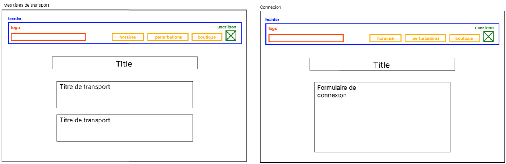
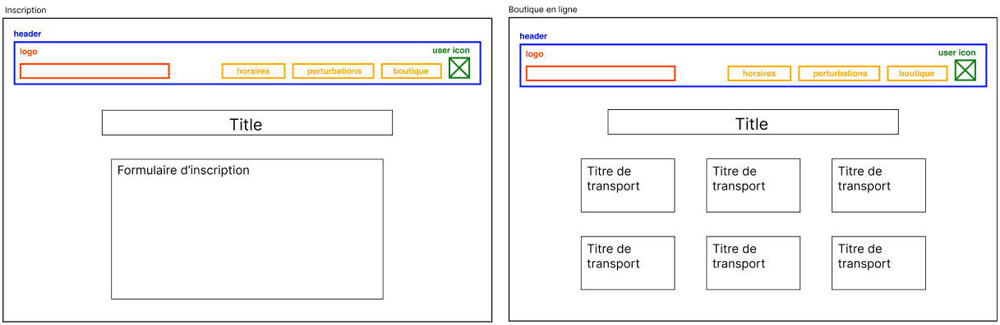
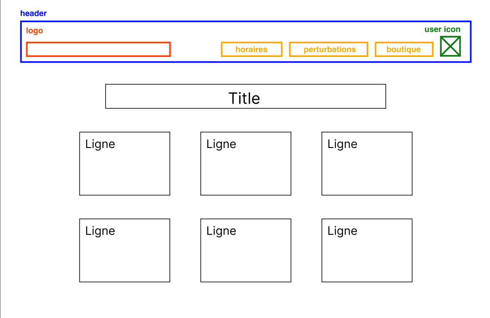
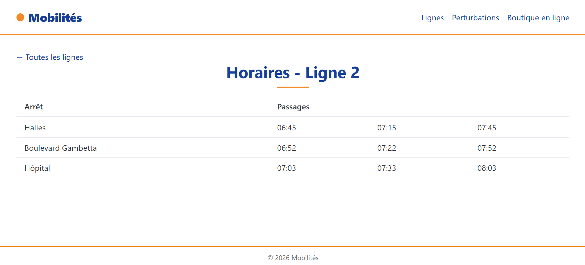
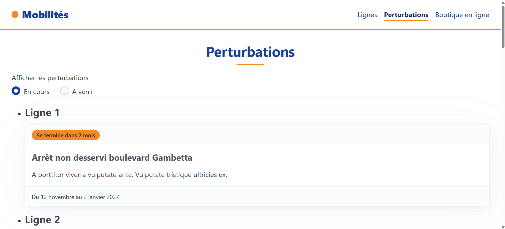

# Réduction de l'impact écologique du service numérique de l'opérateur de mobilités troyen
## Choix du sujet

Avec l'essor d'internet et des téléphone portable, nous utilisons quotidiennement des sites internet et applications pour consulter les horaires des différents transports en communs ou encore nous repérer. Compte tenu de nos usages, il nous a donc paru pertinent de choisir ce projet là pour essayer de réduire son impact écologique. Ainsi tout au long de ce semestre, nous analyserons les enjeux liés aux applications de transports en communs et de calcul d'itinéraire afin de proposer une solution plus respectueuse de l'environnement tout en conservant son coeur d'action.

## Utilité sociale

L'application centralise horaires, info trafic, achat de titres et vélos en libre-service. Elle facilite l'accès aux transports pour ceux qui n'ont pas de voiture : jeunes, étudiants, personnes âgées, ménages modestes. Ils accèdent plus simplement aux soins, aux études et aux services. Elle encourage aussi le vélo et les transports en commun, donc l'activité physique et une moindre pollution locale.

Elle relie les différentes offres de l'agglomération : bus, transport à la demande, bus-train, vélos. Elle facilite l'accès à l'emploi, le lien centre-périphérie et l'attractivité du centre-ville.

L'application est gratuite, gérée par un opérateur public, et jamais obligatoire. Le téléphone, le site, les fiches horaires et le point de vente restent disponibles. Ses usages sont souples : horaires pour l'étudiant, itinéraire pour le touriste, Marcel pour le cycliste.

## Effets de la numérisation

Les fiches imprimées constituent la principale solution pour la consultation des horaires de transports en communs. La fabrication du papier qui constitue ces fiches représente 5g de CO2 par feuille A4 de 80g/m² et l'impression sur une de ces feuilles est estimée à 2g de CO2. 
Cet impact n'est qu'une estimation, pour la fabrication du papier, ces chiffres varient en fonction du grammage du papier, de si la feuille est recyclée ou non, de la  distance à laquelle il est produit, de l'impact écologique de l'électricité utilisée.
Il est aussi important de garder en tête que les arbres ne sont presque plus abattus uniquement pour produire du papier, la pâte à papier est majoritairement faite de déchets forestiers sans aucune autre utilité. De plus, plus de 60% de l'énergie thermique utilisée pour faire du papier vient de la biomasse ce qui mitige d'autant plus l'impact environnemental de la production de papier.
Quand à l'impression, ces chiffres peuvent varier en fonction de l'encre utilisée et du procédé d'impression utilisé. 
L'application devra ainsi battre cet impact écologique en sachant qu'un utilisateur peut utiliser plusieurs feuilles et que les feuilles peuvent êtres utilisées par plusieurs personnes. (source: [Docside](https://docside.fr/empreinte-carbone-de-limpression-papier-comprendre-pour-agir/ ))

L'application peut remplacer les tickets papier, les fiches imprimées et les appels, à condition que ces supports diminuent réellement. L'enjeu principal reste de remplacer la voiture par le bus ou le vélo. En revanche, l'application substitue des services déjà présents dans l'agglomération en dupliquant certaines fonctionnalités notamment celles de Karos ou encore Marcel.

Plus de facilité peut entraîner plus de déplacements, ou des trajets à pied remplacés par le bus. Le temps réel pousse aussi à consulter l'appli souvent. Ces effets restent limités face au gain d'un report depuis la voiture.

## Scénarios d'usage et impacts

Nous faisons l'hypothèse qu'un utilisateur va consulter les horaires de bus plusieurs fois dans la journée (par exemple pour se rendre au travail, aller faire du sport, voir des amis etc.). Pour cette raison, nous prendrons en compte dans notre scénario, la consultation consécutive des horaires de deux lignes de bus, afin de pouvoir quantifier les effets positifs du cache.

Après analyse de différents services similaires, comme [TCAT](tcat.fr), [Ile de france mobilités](https://www.iledefrance-mobilites.fr), [CityMapper](https://www.iledefrance-mobilites.fr) ou encore [Google Maps](https://www.google.fr/maps), nous sommes arrivés aux scénarios suivants.

### Scénario 1: "Consulter les horaires de passage d'une ligne de bus"
1. L'utilisateur se rend sur la page "horaires de bus" de l'application grâce à un bouton (donc sans passer par un moteur de recherche). Si nécessaire, il donne son consentement. Puis il consulte les différentes lignes de bus disponibles.
2. Il choisit une ligne de bus et prend connaissance des horaires de passage de cette dernière.
3. Il revient à la page "horaires et plans de bus" et consulte les différentes lignes de bus disponible.
4. Il choisit une autre ligne de bus et prend connaissance des horaires de passage cette dernière.


### Scénario 2 : "Être informé des perturbations du traffic"
1. L'utilisateur se rend sur la page "perturbations" de l'application grâce à un bouton (donc sans passer par un moteur de recherche). Si nécessaire, il donne son consentement. Puis il consulte les différentes perturbations du réseau.
2. Il sélectionne les perturbations à venir et prends connaissance des perturbations sur le réseau
3. Il retourne sur les perturbations en cours.

## Impact de l'exécution des scénarios auprès de différents services concurrents

L'EcoIndex d'une page (de A à G) est calculé (sources : [EcoIndex](https://www.ecoindex.fr/comment-ca-marche/), [Octo](https://blog.octo.com/sous-le-capot-de-la-mesure-ecoindex), [GreenIT](https://github.com/cnumr/GreenIT-Analysis/blob/acc0334c712ba68939466c42af1514b5f448e19f/script/ecoIndex.js#L19-L44)) en fonction du positionnement de cette page parmi les pages mondiales concernant :

- le nombre de requêtes lancées,
- le poids des téléchargements,
- le nombre d'éléments du document.

Nous avons choisi de comparer l'impact des scénarios sur les services d'opérateurs de mobilités : TCAT, Île-de-France Mobilités et CityMapper à titre de comparaison.

| Service                             | Score (sur 100) | Classe | Détail des mesures                  |
| ----------------------------------- | --------------- | ------ | ----------------------------------- |
| TCAT                                | 42              | D      | […](benchmark/tcat.md)              |
| Île-de-France Mobilités             | 45              | D      | […](benchmark/idfm.md)              |
| CityMapper (à titre de comparaison) | 31              | E      | […](benchmark/citymapper.md)        |

Les mesures de l'impact moyen de ces services (cf. Tab.1) révèlent des classes EcoIndex moyennes (D) pour les deux opérateurs publics, et faibles (E) pour CityMapper.  

Dans le détail, les trois services sont pénalisés pour des raisons différentes :

- TCAT : peu de requêtes, mais une page d'accueil extrêmement lourde (plus de 14 Mo), due à des images PNG non optimisées d'environ 650 Ko chacune. Cette seule page est classée F et fait chuter la moyenne du site.
- Île-de-France Mobilités : des pages légères et un DOM réduit, mais un très grand nombre de requêtes (entre 184 et 296 par page).
- CityMapper : un DOM très volumineux (plus de 1 000 éléments sur quatre pages sur cinq) et des pages lourdes, probablement liées à la carte interactive et à ses scripts.

L'exécution des scénarios apporte deux enseignements. D'une part, le cache peut réduire fortement l'impact d'une consultation répétée : sur le site de la TCAT, la fiche horaires d'une deuxième ligne ne nécessite que 9 requêtes et 45 Ko, contre 57 requêtes et 1,7 Mo pour la première. D'autre part, le choix de tout charger d'un coup a un coût : la page « Infos trafic » de la TCAT charge les perturbations de tout le réseau, même si l'utilisateur ne s'intéresse qu'à une seule ligne.

À l'inverse, le bon classement (C) de certaines pages, comme la page « Infos trafic » d'Île-de-France Mobilités ou les pages « Boutique en ligne » et « Points de vente » de la TCAT, montre qu'il existe une marge de progression significative, à condition d'optimiser les images, de limiter le nombre de requêtes et de simplifier la structure des pages.

Les mesures d'Île-de-France Mobilités et de CityMapper ont été relevées manuellement dans les outils de développement du navigateur, puis converties en note EcoIndex avec la formule du référentiel. Les valeurs des scénarios de ces deux services sont à interpréter avec prudence, le cache n'ayant pas toujours pu être vidé entre les mesures.

## Modèle économique


| Service                             | Modèle économique                      | 
| ----------------------------------- | -------------------------------------- |
| TCAT                                | <ul><li>Financements publics</li><li>Subventions</li><li>Vente de titres de transport</li></ul>| 
| Île-de-France Mobilités             | <ul><li>48% Employeurs (versement mobilité)</li><li>33% Utilisateurs (titres de transports)</li><li>15% Concours publics</li><li>2% État (subventions)</li><li>2% Autres</li> | 
| CityMapper (à titre de comparaison) | Publicités ciblées, Commission sur les moyens de transports alternatifs hors réseau de transport en communs classiques, Frais de licence et d'intégration<ul>Utilisateurs gratuit :<li>Multi-modal routing</li><li>Real-time departures</li> <li>Basic navigation</li><li>Transit alerts</li><ul>Utilisateurs payants :<li>Live location sharing</li><li>Weather</li><li>Priority support</li> | 

Sources : 
- [Rapport d'activité 2018 de la régie des transports en commun de l'agglomeration troyenne](https://troyes-champagne-metropole.fr/wp-content/uploads/2022/06/18-rapport-annuel-tcat.pdf) 
- [Assises de financement transports franciliens](https://www.iledefrance-mobilites.fr/decouvrir/assises-financement-transports-franciliens-2024-2030) 
- [Pricing citymapper](https://www.softwr.com/pricing/citymapper) 
- [Citymapper Ads](https://ads.citymapper.com) 
- [How CityMapper make money](https://productmint.com/citymapper-business-model-how-does-citymapper-make-money/)

### Structure de concurrence

À Troyes, l'application mobilité de la TCAT est en situation de monopole car c'est la seule entreprise à gérer le réseau de transports en communs (bus) de l'agglomération. 

### Sources de financement
La TCAT est financée par le financement public, les subventions ainsi que par la vente de titres de transport. Le financement de notre solution sera donc financée de la même façon.

| Source possible de revenus | Montant unitaire | Quantité nécessaire pour financer un salaire
| --- | --: | --:
| Abonnement mensuel de 4 à 25 ans et abonnement mensuel de 65 ans et plus | 21€  | 170
| Abonnement mensuel de 26 à 64 ans | 42€  | 85
| Titre de transport 1 voyage | 1.35€  | 2 644
| Titre de transport 3 voyage | 3.90€  | 916
| Titre de transport 10 voyage | 11.50€  | 311

## Maquette de l'interface et échantillon de données
### Maquettes
Au vu des différents services comparés, des exigences environnementales exprimées plus haut et des scénarios retenus, nous avons défini pour notre prototype une maquette de l'interface et un échantillon de données réalistes.

Les ressources Web possédant une représentation sur notre application seront au nombre de cinq :

- la page de la boutique en ligne (avec pour chemin `/boutique-en-ligne`).
- la liste des lignes (avec pour chemin `/lignes`).
- les horaires de la ligne sélectionnée (avec pour chemin `/ligne/{id}`).
- les perturbations des lignes (avec pour chemin `/perturbations`).
- une page d'accueil contenant une présentation de l'entreprise et une FAQ (avec pour chemin `/`).

  
  
__Fig.1__: Maquette de l'interface du prototype :  
__a.__ page pour les titres titres de transports de l'utilisateur,
__b.__ page de la boutique en ligne,
__c.__ page de la liste des lignes de transport,
__d.__ page des horaires de la ligne sélectionnée.  
__Fig.2__: Maquette de l'interface du prototype :  
__a.__ page des perturbations des lignes de transports,  
__b.__ page d'accueil,  
__c.__ page du panier de l'utilisateur.

### Échantillon de données

Pour concevoir l’interface sans dépendre d’une vraie base de données, nous avons généré un échantillon fictif avec `dummy-json`. Nous sommes partis du modèle prévu pour des articles de journaux, que nous avons adapté à notre domaine `(data/big_sample_data.hbs)`.  

Le modèle génère entre 6 et 12 lignes de bus avec chacune entre 4 et 9 arrêts, leurs horaires de passage, 0 à 2 perturbations par ligne, ainsi qu’une liste de titres de transport avec leur prix. L’échantillon est ensuite obtenu avec la commande 
```bash
cd data
npx dummy-json sample_data.hbs > sample_data.json
```

Nous avons dû modifier le modèle plusieurs fois avant d’obtenir un résultat cohérent. Les horaires tirés au hasard n’avaient aucun sens dans un tableau de passages, nous les avons donc calculés : chaque arrêt est desservi 6 minutes après le précédent, à 6 h, 7 h et 8 h. De même, la date de fin d’une perturbation est toujours postérieure à sa date de début. 

Les noms de famille anglais fournis par dummy-json ont été remplacés par une liste de noms de rues françaises, et les prix ont été formatés à deux décimales. 

Enfin, repeat ne permettant pas d’accéder au numéro de la ligne parente, nous l’avons mémorisé avec `{{#with}}` pour numéroter les perturbations.

## Implémentation du scénario prioritaire

### Étape de prototypage : Données chargées de manière statique

Pour cette première version du prototype (`v1.0.0`) :

- l'échantillon de données est encore chargé dans le code de manière statique,
- les fonctionnalités implémentées vont au-delà du scénario proritaire ("Consulter les horaires de passage d'une ligne de bus")

Ce scénario nécessite de pouvoir naviguer entre deux types de page : la page qui liste les lignes de bus et la page qui affiche les horaires de la ligne  sélectionnée.

### Page des lignes de bus

Nous avons développé la page des lignes de bus (cf. Fig. 3) pour qu'elle affiche l'échantillon de données sous une forme proche de ce que prévoyait la maquette.


__Fig.3__: Prototype de la page des lignes de bus.

Pour l'instant, nous avons choisi un *framework* de mise en page minimaliste ([*PicoCSS*](https://picocss.com)).
Dans la suite du projet, nous verrons si l'impact environnemental du passage à un *framework* de mise en page plus puissant (comme [*Bootstrap*](https://getbootstrap.com)) est acceptable.

De même, nous avons décidé, contrairement à l'ensemble des services concurrents, de ne pas inclure de contenu autre que la liste des lignes de bus dans cette page.
Dans l'état actuel du prototype, il est possible d'avoir une première idée de l'impact environnemental du *frontend*.
Bien entendu, il manque encore le chargement dynamique des données, mais nous pouvons déjà évaluer l'impact de l'affichage des données et du *framework* (au sens large : *React*, *PicoCSS*, *DayJS*).
Cette évaluation de l'impact (cf. Tab.4) est déjà encourageante en mode "pré-production" mais encore plus en mode "développement".

|   | EcoIndex| GES (gCO2e) | Taille du DOM | Requêtes | Taille de la page (ko)
|---|--------:|------------:|--------------:|---------:|---------------------:
| Mode "développement"  | 73 B 🟩 |  1,5 | 43 | 44 | 5729
| Mode "pré-production" | 94 A 🟦 | 1,1 | 40 | 4 | 105

__Tab.4__: Évaluation de l'impact du prototype de la page des lignes de bus.

### Pages des horaires

Les pages des articles ont pour HTTP-URI `/horaires/{id}`.
De même que précédemment, nous avons tenté d'implémenter cette page (cf. Fig. 4) conformément à ce que prévoyait la maquette.


__Fig.4__: Prototype de la page des horaires d'une ligne.

Avec l'ajout de ce modèle de page et la mise en place de la navigation entre les deux modèles, il devient possible d'exécuter le scénario prioritaire complet et de mesurer son impact.

|   | EcoIndex| GES (gCO2e) | Taille du DOM | Requêtes | Taille de la page (ko)
|---|--------:|------------:|--------------:|---------:|---------------------:
| 1. Consulter les lignes de bus 					   | 94 A 🟦 | 1,1 | 40 | 4 | 105
| 2. Choisir une ligne et consulter ses horaires 			   | 93 A 🟦 | 1,1 |  50 | 4 | 105
| 3. Revenir aux lignes de bus et les consulter	| 94 A 🟦 | 1,1 | 40 | 4 | 105
| 4. Choisir et consulter les horaires d'une autre ligne 		| 94 A 🟦 |  1,1|  45 | 4 | 105

__Tab.5__: Évaluation de l'impact du scénario "Consulter les horaires d'une ligne de bus" dans le prototype v1.0.0.

Ces estimations bien qu'artificiellement basses (puisque les données sont chargées de manière statique) sont tout de même à comparer avec [celles des services concurrents](https://htmlpreview.github.io/?https://raw.githubusercontent.com/UTT-GL03/Mobilites/main/benchmark/tcat.md) vues précédemment.

Si nous arrivons à maintenir les émissions en dessous de 1,2 g par page pour notre produit minimum viable, nous pouvons donc espérer proposer une alternative environ 2 fois moins impactante que les services existants (en incluant pourtant la participation au cycle de vie du terminal).

### Pages des perturbations

Les pages des articles ont pour HTTP-URI `/perturbations/`.
De même que précédemment, nous avons tenté d'implémenter cette page (cf. Fig. 5) conformément à ce que prévoyait la maquette.


__Fig.5__: Prototype de la page des perturbations.

Avec l'ajout de ce modèle de page et la mise en place de la navigation entre les deux modèles, il devient possible d'exécuter le second scénario prioritaire complet et de mesurer son impact.

|   | EcoIndex| GES (gCO2e) | Taille du DOM | Requêtes | Taille de la page (ko)
|---|--------:|------------:|--------------:|---------:|---------------------:
| 1. Consulter les perturbations 					   | 90 A 🟦 | 1,2 | 136 | 4 | 106
| 2. Consulter les perturbations à venir 			   | 90 A 🟦 | 1,2 |  127 | 4 | 106
| 3. Reconsulter les perturbations en cours	| 90 A 🟦 | 1,2 | 136 | 4 | 106

__Tab.6__: Évaluation de l'impact du scénario "Consulter les perturbations du réseau" dans le prototype v1.0.0.

Ces estimations bien qu'artificiellement basses (puisque les données sont chargées de manière statique) sont tout de même à comparer avec [celles des services concurrents](https://htmlpreview.github.io/?https://raw.githubusercontent.com/UTT-GL03/Mobilites/main/benchmark/tcat.md) vues précédemment.

Si nous arrivons à maintenir les émissions en dessous de 1,3 g par page pour notre produit minimum viable, nous pouvons donc espérer proposer une alternative environ 2 fois moins impactante que les services existants (en incluant pourtant la participation au cycle de vie du terminal).

### Étape de prototypage : Données statiques chargées de manière dynamique

Pour cette nouvelle version du prototype (`v1.0.1`), identique du point de vue fonctionnel, les données (toujours statiques) sont désormais chargées par le *frontend* à travers le réseau immédiatement après un premier affichage à vide.
Ce comportement, plus réaliste, n'a pour effet qu'une requête supplémentaire par page affichée. 

Concernant l'évaluation de l'impact environnemental du scénario, par rapport au tableau précédent (cf. Tab.5), à l'exception du nombre de requêtes qui est incrémenté de 1, les résultats sont strictement identiques.

### Automatisation
À la racine du projet exécuter la commande suivante pour générer le rapport d'impact écologique du premier scénario "Consulter les horaires: de passage d'une ligne de bus" :
```bash
 greenit analyse scenarios/consulter_horaires.yml horaires.html --headless false 
```

Pour le second scénario "Être informé des perturbations du traffic", exécuter la commande suivante :
```bash
greenit analyse scenarios/consulter_perturbations.yml perturbations.html --headless false
```

## Mesures de la consommation énergétique lors du passage à l'échelle

Maintenant que notre prototype est réaliste en termes de nombre de requêtes, nous pouvons simuler les effets du "passage à l'échelle". 

Dans le cas qui nous occupe de la mobilité et dans le cadre des fonctionnalités envisagées (consultation d'horaires), l'augmentation de la quantité des données à traiter ne viendra pas de l'augmentation du nombre de lignes. En revanche, l'évolution de l'EcoIndex se fera probablement sur l'augmentation des perturbations du trafic.

L'augmentation du volume de données est stagnante, la création ou la suppression de lignes de bus interviennent 1 fois par an, bien que ces changements provoquent des modifications dans le volume d'horaires, l'évolution reste marginale puisque ces créations ou suppressions restent peu nombreuses.
Cependant, la majeure partie de l'évolution des données se fait dans les perturbations du trafic. Cette évolution est elle aussi stagnante sur le long terme puisque si la création de perturbations reste imprévisible, chaque perturbation finira par être supprimée lorsqu'elle prendra fin.

### Évolution de l'EcoIndex lors du passage à l'échelle

Produites désormais de manière automatique lors de l'intégration continue, les mesures nécessaires à la production de l'EcoIndex, [avant](https://github.com/UTT-GL03/Mobilites/actions/runs/43883380327) et [après](https://github.com/UTT-GL03/Mobilites/actions/runs/43909317601/artifacts/14246454060) la simulation du passage à l'échelle retraduisent bien (cf. Tab.7) l'augmentation du poids des téléchargements, mais aussi de l'augmentation du nombre d'éléments de la page des titres.


|   | EcoIndex| GES (gCO2e) | Taille du DOM | Requêtes | Taille de la page (ko)
|---|--------:|------------:|--------------:|---------:|---------------------:
| 1. Consulter les lignes de bus 					   | <del>88 A 🟦</del><br/>33 E 🟥 | <del>1,2</del><br/>2,3 | <del>79</del><br/>4361 | 1 | <del>20</del><br/>3923
| 2. Choisir une ligne et consulter ses horaires 			   | <del>89 A 🟦</del><br/>75 B 🟩 | <del>1,2</del><br/>1,5 | <del>70</del><br/>75 | 1 | <del>20</del><br/>3923
| 3. Revenir aux lignes de bus et les consulter	| <del>88 A 🟦</del><br/>33 E 🟥 | <del>1,2</del><br/>2,3 | <del>79</del><br/>4361 | 1 | <del>20</del><br/>3923
| 4. Choisir et consulter les horaires d'une autre ligne 		| <del>88 A 🟦</del><br/>77 A 🟦 |  <del>1,2</del><br/>1,5 | <del>80</del><br/>60 | 1 | <del>20</del><br/>3923

__Tab.7__: Effet du passage à l'échelle sur l'impact du scénario "Consulter les horaires d'une ligne de bus" dans le prototype v1.0.1.

On pourrait s'étonner que la baisse de l'EcoIndex soit beaucoup plus forte pour la page des lignes de bus que pour la page des horaires d'une ligne alors que l'augmentation du poids des téléchargements est analogue.
Ceci s'explique par le fait que l'EcoIndex vise à évaluer un impact global, incluant une part de la fabrication et de la fin de vie des terminaux, et que cette part augmente avec le nombre d'éléments de la page.
Pour évaluer plus précisément l'impact de la consultation elle-même nous utiliserons un autre outil de mesure : GreenFrame.

### Mesure de la consommation énergétique liée à la consultation

Le logiciel GreenFrame est capable d'estimer, pour les différents composants de l'architecture, la consommation énergétique :

- du CPU (à partir du temps de calcul),
- de la mémoire vive (à partir de la taille des données mémorisées),
- du disque (à partir de la taille des données lues et écrites),
- du réseau (à partir de la taille des données reçues et envoyées),
- pour le navigateur uniquement, de l'écran (à partir du temps d'exécution du scénario).

| HORAIRES    | cpu (Wh)   | mem (Wh)   | disk (Wh) | network (Wh)       | screen (Wh)        | total (Wh) |
|-------------| ---------- | ---------- | --------- | ------------------ | ------------------ | ---------- |
| Navigateur  | 0.0035     | 0.000069   | 0.0       | <mark>0.024</mark> | <mark>0.052</mark> | 0.081      |
| Serveur Web | 0.000014   | 0.0000060  | 0.0       | <mark>0.025</mark> | 0.0                | 0.025      |

| PERTURBATIONS | cpu (Wh)   | mem (Wh)   | disk (Wh) | network (Wh)       | screen (Wh)        | total (Wh) |
|---------------| ---------- | ---------- | --------- | ------------------ | ------------------ | ---------- |
| Navigateur    | 0.010      | 0.00017    | 0.0       | <mark>0.025</mark> | <mark>0.046</mark> | 0.081      |
| Serveur Web   | 0.000011   | 0.0000052  | 0.0       | <mark>0.025</mark> | 0.0                | 0.025      |

__Tab.8__: Estimation de la consommation énergétique, après le passage à l'échelle, des scénarios "Consulter les horaires de passage d'une ligne de bus" (premier tableau) et "Être informé des perturbations du trafic" (second tableau).

Par rapport à ce que pouvait laisser penser l'EcoIndex (cf. Tab.7) qui pénalise fortement les pages affichant un grand nombre 
d'éléments comme la page des lignes de bus, les résultats (cf. Tab.8) indiquent que la consommation due à la consultation 
des perturbations (avec ses milliers de perturbations affichées) est équivalente à celle de la consultation des horaires 
de deux lignes (environ 0,105 Wh et 47 mg eq. CO2 par scénario). Autrement dit, l'affichage en lui même de ces données en 
grand nombre est négligeable par rapport à la transmission de ces données sur le réseau : le temps de calcul du navigateur 
est bien trois fois plus élevé pour les perturbations, mais il reste négligeable. Dans les deux cas, c'est en effet 
l'intégralité de l'échantillon de données (environ 4 Mo) qui est téléchargée, quelle que soit la page consultée.

Par contre, l'affichage de ces données a bien un impact indirect : en augmentant le temps de lecture, il a un 
effet déterminant sur le temps d'éclairage de l'écran.

De fait, les trois éléments ayant le plus d'impact (le reste étant négligeable), sont ici :
- l'écran du client (environ la moitié de la consommation totale),
- le réseau du client,
- le réseau du serveur.

